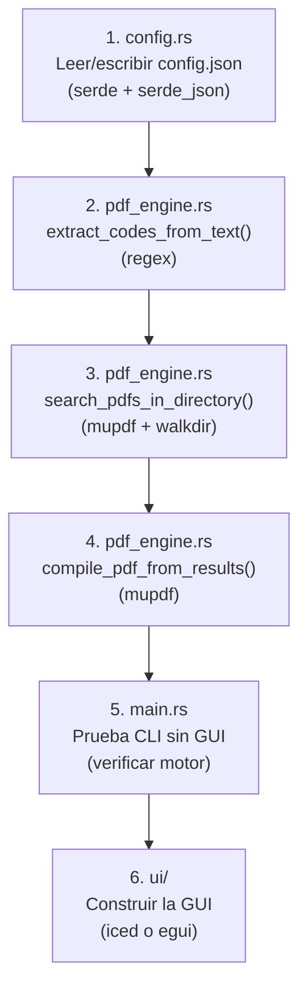

# Migración de visor-pdf a Rust — Guía Completa

## 1. Radiografía del Proyecto Python Actual

El proyecto tiene **3 capas bien separadas**:

| Capa | Archivo | Líneas | Responsabilidad |
|:--|:--|--:|:--|
| Configuración | [config.py](file:///c:/Users/micha/Desktop/visor-pdf/src/config.py) | 47 | Lee/escribe `config.json` (coordenadas de corte, último directorio, tema) |
| Motor de Búsqueda | [pdf_processor.py](file:///c:/Users/micha/Desktop/visor-pdf/src/pdf_processor.py) | 199 | Escanea PDFs, extrae texto por región, identifica códigos con regex, compila PDF final |
| Interfaz Gráfica | [gui.py](file:///c:/Users/micha/Desktop/visor-pdf/src/gui.py) | 1047 | CustomTkinter + ttk.Treeview, hilos, cola de eventos, renderizado de páginas |

---

## 2. Qué se Migra y Qué Cambia

En Rust **todo se reescribe**, pero la lógica del motor de búsqueda es la que debe trasladarse con mayor fidelidad. La GUI se reconstruye con un framework nativo de Rust.

```
Python                          Rust
─────────────────────────────   ─────────────────────────────
config.py      → config.rs      (serde + serde_json)
pdf_processor.py → pdf_engine.rs (lopdf o mupdf-rs + regex)
gui.py         → ui/ módulos    (iced, egui, o tauri)
main.py        → main.rs        (punto de entrada)
```

---

## 3. Crates (Librerías) Necesarias y Por Qué

### 3.1 Manejo de PDF

| Crate | Para qué | Equivalente Python |
|:--|:--|:--|
| [`mupdf`](https://crates.io/crates/mupdf) | Bindings de MuPDF (la misma librería C que usa PyMuPDF/fitz). Abre PDFs, extrae texto de regiones con clip rect, renderiza páginas a pixmap, inserta páginas en documentos nuevos. **Es la traducción más directa de tu código actual.** | `import fitz` |
| [`lopdf`](https://crates.io/crates/lopdf) | Alternativa Rust-pura (sin dependencia C). Manipula la estructura interna del PDF. Buena para copiar/insertar páginas. No renderiza ni extrae texto con clip regional directamente. | — |

> [!IMPORTANT]
> **Recomendación**: Usa `mupdf` como crate principal. Tu proyecto depende de 3 funciones específicas de MuPDF que `lopdf` no cubre nativamente:
> 1. `page.get_text("text", clip=rect)` — extracción de texto limitada a una región geográfica
> 2. `page.get_pixmap(dpi=120)` — renderizado de página a imagen para vista previa
> 3. `page.draw_rect(rect, color, width)` — dibujo de rectángulo indicador sobre la página

---

### 3.2 Expresiones Regulares

| Crate | Para qué | Equivalente Python |
|:--|:--|:--|
| [`regex`](https://crates.io/crates/regex) | Buscar patrones `[A-Z]{3,15}` y `\d{4,15}` en el texto extraído. Es el estándar de facto en Rust, extremadamente rápido. | `import re` |

---

### 3.3 Configuración y Serialización

| Crate | Para qué | Equivalente Python |
|:--|:--|:--|
| [`serde`](https://crates.io/crates/serde) | Framework de serialización/deserialización. Define la estructura `AppConfig` con `#[derive(Serialize, Deserialize)]` y automáticamente la lee/escribe desde JSON. | `json.load()` / `json.dump()` |
| [`serde_json`](https://crates.io/crates/serde_json) | Backend JSON para serde. Lee y escribe el archivo `config.json`. | `import json` |

---

### 3.4 Sistema de Archivos y Utilidades

| Crate | Para qué | Equivalente Python |
|:--|:--|:--|
| [`walkdir`](https://crates.io/crates/walkdir) | Recorre recursivamente directorios buscando archivos `.pdf`. Más robusto y rápido que `std::fs::read_dir` recursivo manual. | `os.walk()` |
| [`rayon`](https://crates.io/crates/rayon) | Paralelismo de datos. Permite procesar múltiples PDFs en paralelo con un simple `.par_iter()`. Reemplaza el `threading.Thread` de Python pero con paralelismo real (sin GIL). | `threading.Thread` |
| [`rfd`](https://crates.io/crates/rfd) | Diálogos nativos del sistema operativo: selector de carpetas (`FileDialog::pick_folder()`) y guardar archivo (`FileDialog::save_file()`). | `tkinter.filedialog` |

---

### 3.5 Interfaz Gráfica — Opciones

| Crate | Estilo | Complejidad | Mejor para |
|:--|:--|:--|:--|
| [`iced`](https://crates.io/crates/iced) | Declarativo tipo Elm. Widgets nativos con renderizado GPU. | Media | Apps de escritorio con layout de paneles, tablas, botones. **Recomendado para este proyecto.** |
| [`egui`](https://crates.io/crates/egui) + [`eframe`](https://crates.io/crates/eframe) | Modo inmediato. Cada frame redibuja todo. | Baja | Prototipos rápidos, herramientas internas, debugging. |
| [`tauri`](https://tauri.app/) | HTML/CSS/JS para la UI + Rust para el backend. | Alta (requiere frontend web) | Si quieres una UI web con la lógica en Rust. |

> [!TIP]
> **Para este proyecto recomiendo `iced`** porque:
> - Soporta layouts de 3 columnas (sidebar + tabla + visor) de forma natural.
> - Tiene widget de `Image` que acepta bytes PNG directamente.
> - Tiene `PickList`, `TextInput`, `Button`, `ProgressBar` nativos.
> - La arquitectura Elm (Model → Message → Update → View) mapea limpiamente a tu flujo actual.

---

### 3.6 Exportación a Excel

| Crate | Para qué | Equivalente Python |
|:--|:--|:--|
| [`rust_xlsxwriter`](https://crates.io/crates/rust_xlsxwriter) | Genera archivos `.xlsx` con formato, hojas y celdas. | `openpyxl` |

---

## 4. Cargo.toml Base

```toml
[package]
name = "visor-pdf"
version = "0.1.0"
edition = "2021"

[dependencies]
# PDF
mupdf = "0.4"

# Regex
regex = "1"

# Configuración
serde = { version = "1", features = ["derive"] }
serde_json = "1"

# Filesystem
walkdir = "2"

# Paralelismo
rayon = "1"

# GUI
iced = { version = "0.13", features = ["image"] }

# Diálogos nativos
rfd = "0.15"

# Excel (opcional)
rust_xlsxwriter = "0.79"
```

---

## 5. Traducción de la Lógica Central

### 5.1 config.rs — Equivalente de [config.py](file:///c:/Users/micha/Desktop/visor-pdf/src/config.py)

```rust
use serde::{Deserialize, Serialize};
use std::fs;
use std::path::Path;

const CONFIG_FILE: &str = "config.json";

#[derive(Debug, Clone, Serialize, Deserialize)]
pub struct AppConfig {
    pub crop_x0: i32,
    pub crop_y0: i32,
    pub crop_width: i32,
    pub crop_height: i32,
    pub last_directory: String,
    pub theme_mode: String,
}

impl Default for AppConfig {
    fn default() -> Self {
        Self {
            crop_x0: 0,
            crop_y0: 0,
            crop_width: 250,
            crop_height: 150,
            last_directory: String::new(),
            theme_mode: "Dark".to_string(),
        }
    }
}

impl AppConfig {
    /// Carga la configuración desde config.json, o devuelve valores por defecto.
    pub fn load() -> Self {
        if Path::new(CONFIG_FILE).exists() {
            match fs::read_to_string(CONFIG_FILE) {
                Ok(content) => serde_json::from_str(&content).unwrap_or_default(),
                Err(_) => Self::default(),
            }
        } else {
            Self::default()
        }
    }

    /// Persiste la configuración actual en config.json.
    pub fn save(&self) -> Result<(), Box<dyn std::error::Error>> {
        let json = serde_json::to_string_pretty(self)?;
        fs::write(CONFIG_FILE, json)?;
        Ok(())
    }
}
```

**Diferencias clave vs Python:**
- `#[derive(Serialize, Deserialize)]` reemplaza el parseo manual campo por campo de `data.get("crop_x0", 0)`.
- `impl Default` reemplaza los valores por defecto en `__init__`.
- `serde_json::from_str` lee todo el JSON a la struct en una sola línea.

---

### 5.2 pdf_engine.rs — Equivalente de [pdf_processor.py](file:///c:/Users/micha/Desktop/visor-pdf/src/pdf_processor.py)

#### 5.2.1 Lista de Palabras Excluidas

```rust
use std::collections::HashSet;
use once_cell::sync::Lazy; // o usa std::sync::LazyLock en Rust 1.80+

static EXCLUDE_KEYWORDS: Lazy<HashSet<&'static str>> = Lazy::new(|| {
    [
        "SERIE", "NO", "NRO", "NUMERO", "PAGINA", "HOJA", "FECHA", "CODIGO",
        "USUARIO", "CLIENTE", "ID", "FACTURA", "TELEFONO", "TOTAL", "SUBTOTAL",
        "IVA", "EMISION", "VENCIMIENTO", "RUT", "NIT", "RFC", "CUIT",
        "FRENTE", "REVERSO", "ORIGINAL", "COPIA", "INFORME", "MENSUAL",
        "ACTIVIDADES", "REPUBLICA", "NICARAGUA", "REGISTRO", "ESTADO",
    ]
    .into_iter()
    .collect()
});
```

#### 5.2.2 Extracción de Códigos (Estrategia Doble)

```rust
use regex::Regex;
use once_cell::sync::Lazy;

static RE_LETTERS: Lazy<Regex> = Lazy::new(|| Regex::new(r"\b[A-Z]{3,15}\b").unwrap());
static RE_NUMBERS: Lazy<Regex> = Lazy::new(|| Regex::new(r"\b\d{4,15}\b").unwrap());

/// Extrae un par (código_letras, código_números) del texto de la región recortada.
/// Retorna (None, None) si no encuentra candidatos válidos.
pub fn extract_codes_from_text(text: &str) -> (Option<String>, Option<String>) {
    let text = text.trim();
    if text.is_empty() {
        return (None, None);
    }

    // Estrategia 1: Coexistencia en la misma línea
    for line in text.lines() {
        let line = line.trim();
        let letters: Vec<&str> = RE_LETTERS
            .find_iter(line)
            .map(|m| m.as_str())
            .filter(|w| !EXCLUDE_KEYWORDS.contains(w))
            .collect();
        let numbers: Vec<&str> = RE_NUMBERS
            .find_iter(line)
            .map(|m| m.as_str())
            .collect();

        if !letters.is_empty() && !numbers.is_empty() {
            return (
                Some(letters[0].to_string()),
                Some(numbers[0].to_string()),
            );
        }
    }

    // Estrategia 2: Región completa (Fallback)
    let all_letters: Vec<&str> = RE_LETTERS
        .find_iter(text)
        .map(|m| m.as_str())
        .filter(|w| !EXCLUDE_KEYWORDS.contains(w))
        .collect();
    let all_numbers: Vec<&str> = RE_NUMBERS
        .find_iter(text)
        .map(|m| m.as_str())
        .collect();

    if !all_letters.is_empty() && !all_numbers.is_empty() {
        return (
            Some(all_letters[0].to_string()),
            Some(all_numbers[0].to_string()),
        );
    }

    (None, None)
}
```

#### 5.2.3 Escaneo de Directorio y Búsqueda en PDFs

```rust
use mupdf::pdf::PdfDocument;
use mupdf::{Rect, Matrix};
use std::sync::atomic::{AtomicBool, Ordering};
use std::sync::Arc;
use walkdir::WalkDir;

/// Resultado de una coincidencia encontrada en un PDF.
#[derive(Debug, Clone)]
pub struct SearchResult {
    pub filepath: String,
    pub page_num: usize, // Número de página física (1-indexed)
    pub detected_letters: String,
    pub detected_numbers: String,
    pub criterio: String,
}

/// Par de búsqueda: (letras, números, etiqueta del criterio).
#[derive(Debug, Clone)]
pub struct SearchPair {
    pub letters: String,
    pub numbers: String,
    pub label: String,
}

/// Busca códigos en las páginas impares de todos los PDFs de un directorio.
///
/// - `crop_rect`: Rectángulo de recorte (x0, y0, ancho, alto).
/// - `cancel`: Bandera atómica para cancelar la búsqueda desde otro hilo.
/// - `on_progress`: Callback de progreso (archivo_actual, total_archivos, nombre_archivo).
/// - `on_result`: Callback por cada coincidencia encontrada.
pub fn search_pdfs_in_directory(
    directory: &str,
    pairs: &[SearchPair],
    crop_rect: (i32, i32, i32, i32),
    cancel: Arc<AtomicBool>,
    mut on_progress: impl FnMut(usize, usize, &str),
    mut on_result: impl FnMut(SearchResult),
) {
    let (x0, y0, w, h) = crop_rect;
    let rect = Rect::new(
        x0 as f32,
        y0 as f32,
        (x0 + w) as f32,
        (y0 + h) as f32,
    );

    // 1. Recolectar todos los archivos .pdf
    let pdf_files: Vec<String> = WalkDir::new(directory)
        .into_iter()
        .filter_map(|e| e.ok())
        .filter(|e| {
            e.path()
                .extension()
                .map(|ext| ext.eq_ignore_ascii_case("pdf"))
                .unwrap_or(false)
        })
        .map(|e| e.path().to_string_lossy().to_string())
        .collect();

    let total = pdf_files.len();

    // 2. Procesar cada PDF
    for (idx, filepath) in pdf_files.iter().enumerate() {
        if cancel.load(Ordering::Relaxed) {
            break;
        }

        let filename = std::path::Path::new(filepath)
            .file_name()
            .unwrap_or_default()
            .to_string_lossy();
        on_progress(idx + 1, total, &filename);

        // Abrir el documento
        let doc = match PdfDocument::open(filepath) {
            Ok(d) => d,
            Err(_) => continue,
        };

        let page_count = doc.page_count().unwrap_or(0);

        // Recorrer páginas impares (índices 0, 2, 4...)
        let mut page_idx = 0;
        while page_idx < page_count {
            if cancel.load(Ordering::Relaxed) {
                break;
            }

            if let Ok(page) = doc.load_page(page_idx as i32) {
                // Extraer texto solo del clip rect
                let text = page
                    .to_text()  // Nota: en mupdf-rs la API varía, ver sección de notas
                    .unwrap_or_default();

                let (det_letters, det_numbers) = extract_codes_from_text(&text);

                if det_letters.is_none() && det_numbers.is_none() {
                    page_idx += 2;
                    continue;
                }

                let det_l = det_letters.as_deref().unwrap_or("N/D");
                let det_n = det_numbers.as_deref().unwrap_or("N/D");

                // Comparar contra todos los criterios activos
                for pair in pairs {
                    let match_letters = pair.letters.is_empty()
                        || det_l.contains(&pair.letters);
                    let match_numbers = pair.numbers.is_empty()
                        || det_n.contains(&pair.numbers);

                    if match_letters && match_numbers {
                        on_result(SearchResult {
                            filepath: filepath.clone(),
                            page_num: page_idx + 1, // 1-indexed
                            detected_letters: det_l.to_string(),
                            detected_numbers: det_n.to_string(),
                            criterio: pair.label.clone(),
                        });
                        break; // Solo el primer criterio que coincida
                    }
                }
            }

            page_idx += 2;
        }
    }
}
```

#### 5.2.4 Compilación del PDF Consolidado

```rust
/// Compila un nuevo PDF uniendo las páginas seleccionadas (frente + reverso).
pub fn compile_pdf_from_results(
    items: &[SearchResult],
    output_path: &str,
) -> Result<(), Box<dyn std::error::Error>> {
    let output_doc = PdfDocument::new();

    for item in items {
        let src_doc = PdfDocument::open(&item.filepath)?;
        let page_count = src_doc.page_count()? as usize;
        let page_idx = item.page_num - 1; // 0-indexed

        // Copiar frente (impar)
        // Copiar reverso (par posterior, si existe)
        let to_page = if page_idx + 1 < page_count {
            page_idx + 1
        } else {
            page_idx
        };

        // mupdf-rs: graft/insert pages del documento fuente al destino
        // La API exacta dependerá de la versión del crate
        output_doc.insert_pages(&src_doc, page_idx, to_page)?;
    }

    output_doc.save(output_path)?;
    Ok(())
}
```

---

## 6. Estructura de Proyecto Rust Propuesta

```text
visor-pdf-rs/
├── Cargo.toml
├── config.json              # Mismo formato que el actual
├── src/
│   ├── main.rs              # Punto de entrada, lanza la app iced/egui
│   ├── config.rs            # AppConfig con serde
│   ├── pdf_engine.rs        # Motor de búsqueda y compilación
│   └── ui/
│       ├── mod.rs            # App state, Message enum, update(), view()
│       ├── sidebar.rs        # Panel izquierdo (selector carpeta, inputs, botones)
│       ├── results_table.rs  # Panel central (tabla de resultados)
│       └── pdf_viewer.rs     # Panel derecho (renderizado de página PDF)
└── pdfs/                     # Carpeta de PDFs de prueba
```

---

## 7. Conceptos de Rust que Necesitarás

### 7.1 Ownership y Borrowing
La diferencia más fundamental respecto a Python. Cada valor tiene un único dueño. Para pasar datos entre funciones:
- **Move** (`String`): transfiere propiedad.
- **Borrow** (`&str`, `&Vec<T>`): préstamo temporal de solo lectura.
- **Mutable borrow** (`&mut`): préstamo temporal con permiso de escritura.

```rust
// En Python: text = page.get_text("text", clip=rect)
// En Rust: el String se "mueve" al retorno, no se copia
let text: String = page.to_text()?;
let (letters, numbers) = extract_codes_from_text(&text); // &text = préstamo
```

### 7.2 Manejo de Errores (`Result` y `Option`)
Python usa `try/except`. Rust usa `Result<T, E>` y el operador `?` para propagar errores:

```rust
// Python:
//   try:
//       doc = fitz.open(filepath)
//   except Exception as e:
//       print(f"Error: {e}")
//       continue

// Rust:
let doc = match PdfDocument::open(&filepath) {
    Ok(d) => d,
    Err(e) => {
        eprintln!("Error procesando {}: {}", filepath, e);
        continue;
    }
};
```

### 7.3 Concurrencia sin GIL
Python tiene el GIL (Global Interpreter Lock) que limita el paralelismo real en hilos CPU-bound. Rust no tiene esa limitación:

```rust
use rayon::prelude::*;

// Procesar múltiples PDFs EN PARALELO de verdad
pdf_files.par_iter().for_each(|filepath| {
    // Cada PDF se procesa en un hilo separado con paralelismo real
    process_single_pdf(filepath, &pairs, rect, &cancel, &results);
});
```

### 7.4 Closures como Callbacks
Los callbacks (`progress_callback`, `result_callback`) de Python se traducen a closures en Rust:

```rust
// Python: progress_callback=self._worker_progress_cb
// Rust:
search_pdfs_in_directory(
    &folder,
    &pairs,
    crop_rect,
    cancel.clone(),
    |current, total, filename| {
        // Actualizar barra de progreso
        println!("Procesando {}/{}: {}", current, total, filename);
    },
    |result| {
        // Agregar resultado a la tabla
        results.lock().unwrap().push(result);
    },
);
```

### 7.5 Structs como Clases
Python usa clases con `self`. Rust usa `struct` + `impl`:

```rust
// Python:
//   class AppConfig:
//       def __init__(self):
//           self.crop_x0 = 0

// Rust:
struct AppConfig {
    crop_x0: i32,
}

impl AppConfig {
    fn new() -> Self {
        Self { crop_x0: 0 }
    }
}
```

---

## 8. Mapeo Rápido Python → Rust

| Concepto Python | Equivalente Rust |
|:--|:--|
| `import json` | `use serde_json` |
| `import re` | `use regex::Regex` |
| `import os; os.walk()` | `use walkdir::WalkDir` |
| `import fitz` | `use mupdf` |
| `import threading` | `use std::thread` o `rayon` |
| `queue.Queue()` | `std::sync::mpsc::channel()` |
| `threading.Event()` | `Arc<AtomicBool>` |
| `dict` | `struct` con campos nombrados o `HashMap` |
| `list` | `Vec<T>` |
| `set` | `HashSet<T>` |
| `str.strip().upper()` | `text.trim().to_uppercase()` |
| `str.endswith(".pdf")` | `path.extension() == Some("pdf")` |
| `try/except` | `match` sobre `Result` o el operador `?` |
| `None` | `Option::None` |
| `f"texto {var}"` | `format!("texto {}", var)` |
| `for idx, item in enumerate(lista)` | `for (idx, item) in lista.iter().enumerate()` |

---

## 9. Notas sobre el Crate `mupdf`

> [!WARNING]
> El crate `mupdf` en Rust es un binding sobre la librería C de MuPDF. Algunos puntos a tener en cuenta:
>
> - **Extracción de texto con clip**: La API de Rust puede no exponer directamente `get_text(clip=rect)`. Si es así, la alternativa es extraer todo el texto de la página con sus posiciones (usando `text_page.blocks()`) y filtrar manualmente los bloques cuyas coordenadas caigan dentro del rectángulo de corte. Esto es equivalente a lo que MuPDF hace internamente.
> - **Compilación**: `mupdf` requiere que la librería C de MuPDF esté disponible en el sistema. En Windows, el crate generalmente la descarga y compila automáticamente via `mupdf-sys`, pero puede requerir un compilador C (MSVC en Windows).
> - **Alternativa**: Si `mupdf` da problemas de compilación, considera [`pdfium-render`](https://crates.io/crates/pdfium-render) (bindings de PDFium de Chromium) que tiene APIs similares y binarios precompilados para Windows.

---

## 10. Orden de Implementación Recomendado



> [!TIP]
> **Fase 1 (sin GUI)**: Implementa `config.rs` + `pdf_engine.rs` y pruébalos desde un `main.rs` que imprima resultados en la terminal. Esto te permite validar que toda la lógica de búsqueda funciona antes de invertir tiempo en la interfaz gráfica.
>
> **Fase 2 (con GUI)**: Una vez que el motor funcione correctamente desde la línea de comandos, construye la GUI encima.
